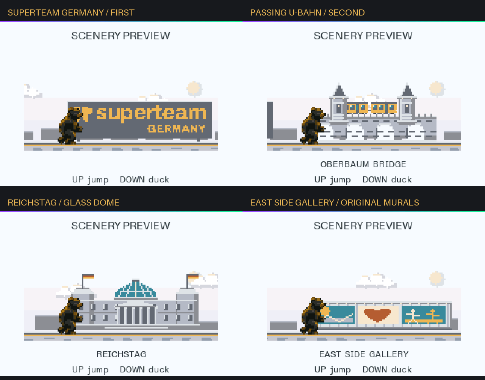

# Berlin Bear Run

A Superteam Germany runner for the Solana BP26 badge. Jump roadworks, duck birds, and run through Berlin with day/night transitions, increasing speed and LED celebrations.



**Controls:** UP jump · DOWN duck · SELECT start/retry/resume · CANCEL pause/exit · RIGHT toggle LEDs in menus.

The game runs locally as a Lua app on Solana OS. Python is only needed for development on your computer.

Tested with desktop checks and the Solana OS browser emulator. Physical badge testing is pending.

## Project structure

| File or folder | Purpose |
| --- | --- |
| [main.lua](main.lua) | Controls, screens, saved scores and LED effects. |
| [game.lua](game.lua) | Movement, collisions, obstacles and difficulty. |
| [art.lua](art.lua) | Bear animation and scenery rendering. |
| [app.json](app.json) | Badge app metadata and permissions. |
| [assets/](assets/) | Packed artwork and data; originals in `assets/source/`. |
| [tools/](tools/) | Asset generators and build/package scripts. |
| [tests/](tests/) | Checks for gameplay, LEDs, scenery and artwork. |

The `.bin` and `.idx` files are compact game assets and lookup data, generated to keep artwork within the badge's memory budget.

## Development

Requires Python 3.9+.

```sh
python3 -m venv .venv
source .venv/bin/activate
python -m pip install -r requirements-dev.txt
python tools/build.py
```

The build prepares assets, runs tests and updates the game package. Use `python tools/build.py --check` to run checks only.

Gameplay settings are in `game.lua`; scenery order and LED patterns are in `tools/build-route-leds.py`.

## License

Code: [MIT](LICENSE). Artwork and branding are excluded and retain their existing rights.

Artwork includes the [Superteam Germany](https://de.superteam.fun/) car and wordmark, plus a bear generated for this game.
